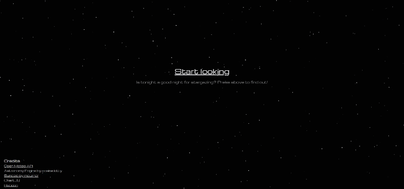

# Star-Watcher
A website that gives you a score for stargazing at any location and shows what planets and constellation you can see.

<h3>Try it: </h3>
<a href="https://qsd808.github.io/Star-Watcher/">Press here to try it</a>

<h3>Features</h3>
1. Get a score for starwatching, based on real-time weather data, the current time, your location and the moon phase 
2. See which planets and constellations are visible to you. 
3. Get more info about planets (rise/set date, distance) 
4. Get more info about constellations (mini map, rise/set date and meaning) 
5. Locate planets and constellations using the compass

<h3>How it works</h3>
For all score related needs, I used the Suncalc libary and the Open-meteo API. For all planet and constallation related needs, I used the Astronomy engine library. This is my first ever coding project, so the code is a bit messy and unoptimized in some places. I did try to add comments where they were needed.

<h3>Credits</h3>
- <a href="https://open-meteo.com/" style="font-size: small; color: rgb(177, 177, 177);">Open Meteo API</a> used to get cloud cover data 
- <a href="https://github.com/cosinekitty/astronomy" style="font-size: small; color: rgb(177, 177, 177);">Astronomy Engine by cosine kitty</a> used for astronomy calculations 
- <a href="https://github.com/mourner/suncalc" style="font-size: small; color: rgb(177, 177, 177);">Suncalc by mourner</a> used for sun and moon score calculations 
- <a href="https://www.chartjs.org/" style="font-size: small; color: rgb(177, 177, 177);">Chart.JS</a> used for the graph 
- <a href="https://www.flaticon.com/free-icon/planets_1789881?term=planet&page=1&position=29&origin=tag&related_id=1789881" style="font-size: small; color: rgb(177, 177, 177);">Flaticon</a> used for the favicon  
- <a href="https://claude.ai" style="font-size: small; color: rgb(177, 177, 177);">Claude</a> used to create planet icons  
- <a href="https://stardance.hackclub.com" style="font-size: small; color: rgb(177, 177, 177);">Stardance</a> used their recources for learning how to ship (this project was also made for Stardance) 
